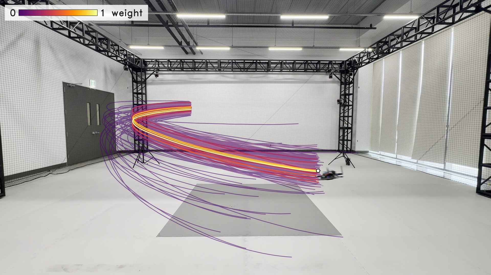
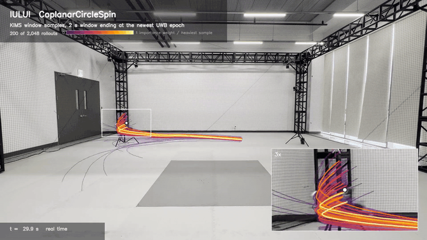
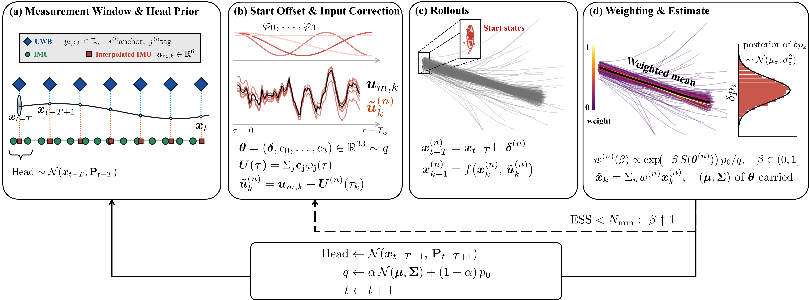
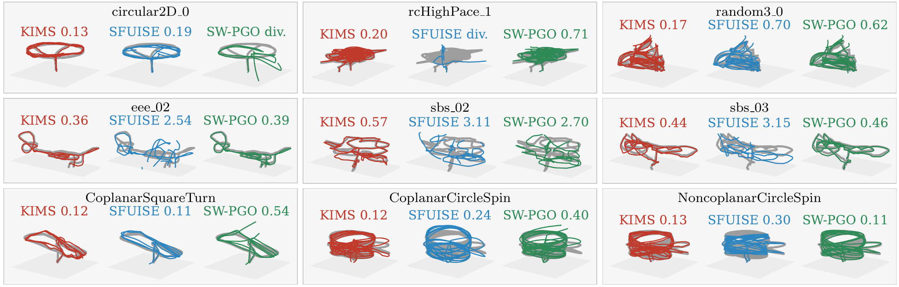
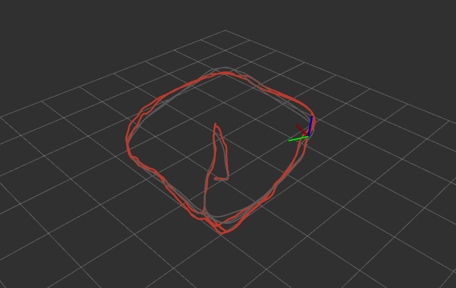

<p align="center">
  
</p>

<h1 align="center">KIMS</h1>

<p align="center">
  <b>Kinematics-Constrained MPPI Smoothing for UWB-IMU 6-DoF Pose Estimation</b><br>
  IEEE Robotics and Automation Letters, under review
</p>

<p align="center">
  <a href="https://am2td.github.io/kims"></a>
  
  
  
</p>

<p align="center">
  <br>
  <sub>A real IULUI flight. 200 of the 8,192 window rollouts, colored by weight.</sub>
</p>

KIMS is a fixed-lag smoother for UWB ranges (two-way ranging or TDOA) and an IMU. It samples IMU input corrections,
rolls every sample through the IMU kinematics on the GPU and weights it by the UWB ranges.

<p align="center"></p>

## Results

Median 3D position RMSE [m] on 104 real flights, UWB and IMU only.

| Dataset | Flights | KIMS | SFUISE | Dataset filter |
|---|:---:|:---:|:---:|:---:|
| MILUV | 13 | **0.135** | 0.704 (3 diverged) | 0.265 (EKF + height sensor) |
| NTU VIRAL | 9 | **0.575** | 2.537 (2 diverged) | – |
| UTIL (TDOA) | 79 | 0.187 | **0.184** (5 diverged) | 0.217 (ESKF) |
| IULUI (ours) | 3 | **0.120** | 0.235 | – |

KIMS never diverges. KIMS values on MILUV, NTU VIRAL and IULUI are means over ten seeds.

<p align="center"></p>

## What you need

| Mode | ROS | Needs | Use it for |
|---|:---:|---|---|
| **Offline**, native build | no | NVIDIA GPU, CUDA 12, CMake, Eigen, Ceres | every run and table in this repository |
| **Docker** | no | NVIDIA container toolkit | the same, without installing anything |
| **catkin** workspace | Noetic | as offline | the offline tools inside a ROS workspace |
| **Online** ROS node | Noetic | as offline | IMU and UWB topics (`rosbag play`) or a bag file |

Without ROS you get everything except the online node. ROS is also used to convert the NTU VIRAL bags and to run
the SFUISE baseline.

## Quick start

```bash
# build
cmake -S . -B build -DKIMS_NO_ROS=ON
cmake --build build -j8                                   # -> build/bin/kims, sw_pgo, pf

# one flight (IULUI ships with the code), score it, plot it
python3 scripts/run.py kims iului SquareTurn
python3 scripts/evaluate.py
python3 scripts/plot.py iului SquareTurn                  # -> result/plots/iului_SquareTurn.png

# all 104 flights, then the tables
scripts/reproduce.sh
```

With Docker:

```bash
docker/build.sh                                           # image kims:v3
docker/run.sh                                             # shell with the GPU, data/ and result/ mounted
scripts/reproduce.sh iului                                # inside the container
```

In a catkin workspace, `catkin_make` builds the same binaries into `devel/lib/kims`; point the scripts at them with
`KIMS_BUILD=<workspace>/build/kims`.

## Online (ROS)

`catkin_make` also builds `kims_online`, the same estimator as a ROS node. It reads `sensor_msgs/Imu` and the
Nooploop LinkTrack tag frames (`nlink_parser/LinktrackTagframe0`, decoded without the message package) and publishes
`/kims_online/pose` (fixed-lag estimate), `/kims_online/pose_now` (newest epoch) and `/kims_online/path`.
The three IULUI flights ship as bags in `data/iului/bags/`.

<p align="center"><br>
<sub><code>rviz:=true</code>: KIMS path (red) and motion capture (gray) on SquareTurn.</sub></p>

```bash
roslaunch kims kims_online.launch seq:=SquareTurn                 # node reads the bag at real time
roslaunch kims kims_online.launch seq:=SquareTurn rate:=0         # as fast as possible
roslaunch kims kims_online.launch seq:=SquareTurn mode:=play      # rosbag play --clock, node subscribes
roslaunch kims kims_online.launch seq:=SquareTurn rviz:=true        # with RViz
```

| Mode | Input | Result on SquareTurn |
|---|---|---|
| `bag` | the bag, recorded times | 0.120 m, same output at any `rate` |
| `play` | topics, arrival times | 0.120 m |
| offline | `scripts/run.py kims iului SquareTurn` | 0.120 m |

In `play` mode an estimate is out 17 ms (median) after its UWB epoch on an RTX 5070 Ti, most of it the wait for
the next IMU sample (50 Hz).
`bag` mode gives the offline output except for the order of ranges that share a time stamp, which the offline
loader sorts. `seq` picks the anchors, tag offsets and start pose of a flight. The estimator settings are the paper's.

## Data

| Dataset | Get it |
|---|---|
| IULUI | in `data/iului/` |
| MILUV | `scripts/prepare_data.sh miluv` |
| NTU VIRAL | download `eee_01` … `sbs_03`, then `scripts/prepare_data.sh ntu <dir with the zips>` (needs ROS `rosbag`) |
| UTIL | unpack the UTIL release, then `scripts/prepare_data.sh util <UTIL root>` |

## Running

```bash
python3 scripts/run.py <kims|swpgo|pf> <miluv|ntu|util|iului> <sequence> [--label L] [key:=value ...]
python3 scripts/evaluate.py [labels ...]                   # position and orientation RMSE, Tables I and III
python3 scripts/plot.py <dataset> [sequences ...] [--labels ...]
METHODS="kims swpgo pf" scripts/reproduce.sh iului         # every estimator on IULUI
```

`kims` runs with the paper's configuration (Table II), built in as the defaults. `swpgo` and `pf` are the
sliding-window pose-graph and bootstrap particle-filter baselines of Table III.
Any setting can be overridden:

```bash
python3 scripts/run.py kims ntu sbs_02 seed:=7 --label seed7
python3 scripts/run.py kims miluv default_1_random3_0 N:=8192 --label n8192
python3 scripts/run.py swpgo iului SquareTurn robust_delta:=0 --label swpgo_norob
```

Keep `KIMS_OMP_THREADS=8` (the default) for bit-identical tables, and about 0.8 GB of GPU memory per KIMS run.
[`result/reference_tables.txt`](result/reference_tables.txt) holds the scores of the runs behind the paper.

<details>
<summary>Output files</summary>

Every run writes `result/<dataset>/<label>_<sequence>_*.txt` and `result/logs/<label>_<sequence>.log`.

| File | Content |
|---|---|
| `_pose.txt` | `t x y z qx qy qz qw`; KIMS rows carry the newest epoch's time with the window head `T-1` epochs earlier |
| `_now_pose.txt` | KIMS state at the newest epoch (lag 0) |
| `_flush_pose.txt` | KIMS states of the first and last windows, for whole-flight scoring |
| `_timing.txt` | solve time per epoch [ms] |
| `_ess.txt`, `_bias.txt`, `_head.txt` | KIMS effective sample size, tempering passes, bias and head diagnostics |

</details>

<details>
<summary>Notes on reproducing the paper</summary>

- `reference_tables.txt` uses seed 1234. Table I averages ten seeds, so NTU `sbs_02` (0.411 against 0.575) and
  `nya_02` (3.085 against 2.590), where the seeds disagree, differ from it.
- SW-PGO reproduces the RMSE of Table III to six decimals. Its poses on MILUV, NTU VIRAL and IULUI can differ in the
  seventh decimal.
- SFUISE and the dataset filters are external code. [baselines/](baselines/README.md) has the patches and scripts
  we used; their outputs are scored by `scripts/evaluate.py sfuise`.

</details>

## Repository

```
src/          kims_node.cu, kims_solver.cu (KIMS), kims_online.cpp (ROS node), sw_pgo.cpp, pf.cpp
include/      solver, IMU dynamics, data loading
scripts/      run.py, reproduce.sh, evaluate.py, plot.py, prepare_data.sh (+ prepare/)
baselines/    SFUISE and dataset filters: patches and helper scripts
data/         IULUI flights (CSV and bags), MILUV and NTU VIRAL anchors and start poses
launch/       kims_online.launch (online ROS node) and its RViz view
docker/       Dockerfile, build.sh, run.sh
docs/         project page
```

## License

MIT, see [LICENSE](LICENSE). The datasets keep their own licenses.
